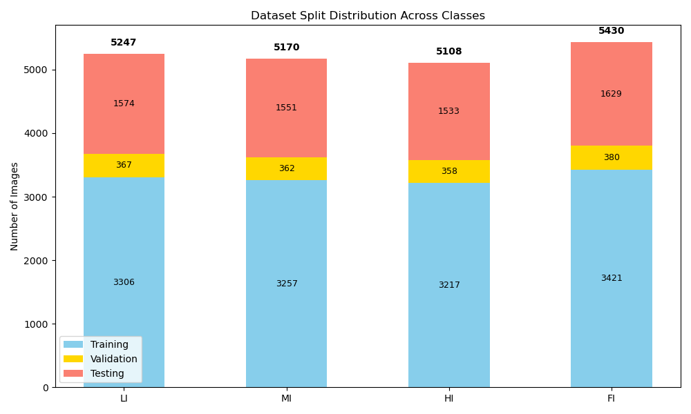
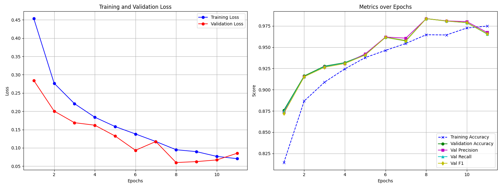
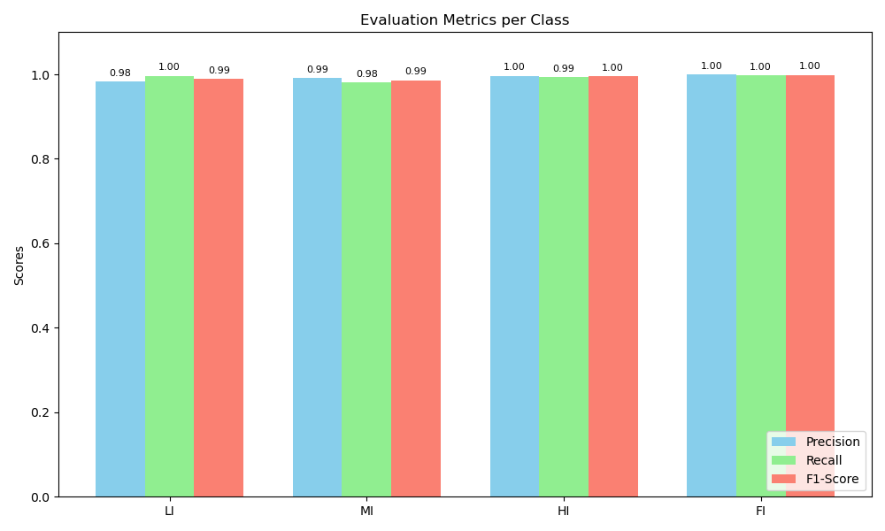
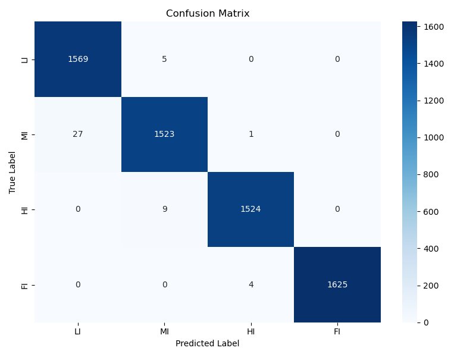
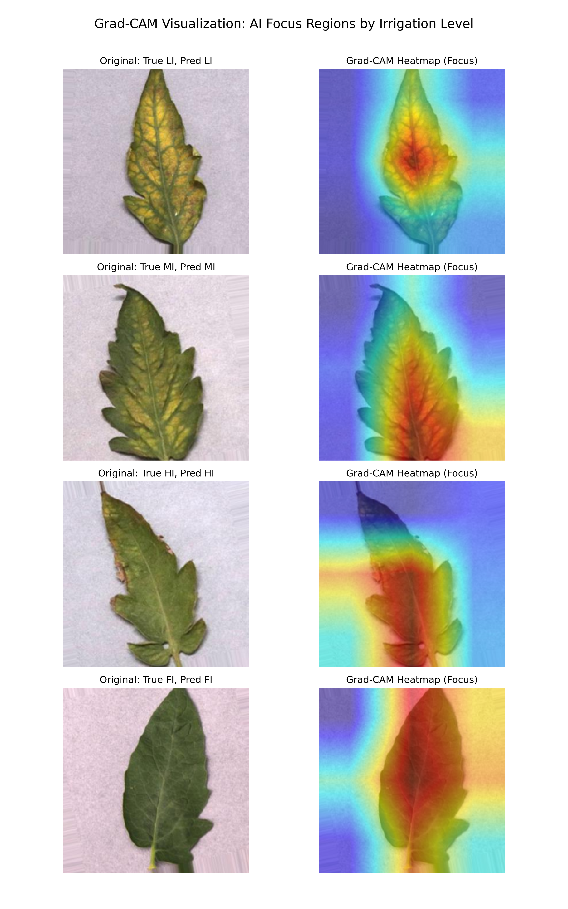

# SmartIrrigation-Vision 🍅💧

[](https://www.python.org/)
[](https://pytorch.org/)
[](https://github.com/rohitt2008/SmartIrrigation-Vision)
[](https://github.com/rohitt2008/SmartIrrigation-Vision)
[-blue?style=for-the-badge)](https://github.com/rohitt2008/SmartIrrigation-Vision)
[](LICENSE)

> **Deep Learning-Based Method for Irrigation Status Detection in Tomato (*Solanum lycopersicum*) Plants Using Leaf Canopy Imagery**

---

## 📌 Executive Summary

Precision water management is essential for sustainable agriculture, climate adaptation, and crop yield optimization. Traditional irrigation scheduling methods rely on invasive soil moisture sensors, weather stations, or destructive laboratory measurements of plant water potential. These solutions are labor-intensive, localized, and difficult to scale across broad agricultural operations.

**SmartIrrigation-Vision** provides a non-invasive, vision-based artificial intelligence solution that detects four discrete irrigation stress levels directly from leaf canopy images. By engineering a custom, lightweight Convolutional Neural Network—**LightResNet-50**—this repository demonstrates that edge-deployable deep learning can achieve clinical-grade accuracy (**99.30% Test Accuracy**, **0.9907 Cohen's Kappa**) while slashing model size from **23.59M parameters down to 1.24M parameters** (a **94.7% parameter reduction**).

Integrated with **Gradient-weighted Class Activation Mapping (Grad-CAM)**, the system offers transparent, interpretable visual evidence confirming that predictions are anchored to biological stress indicators (e.g., cell turgor, leaf curl, and chlorosis) rather than spurious background artifacts.

---

## 🌟 Key Highlights & Engineering Achievements

* 🔬 **100% Replication of Research Methodology**: Fully implements the experimental pipeline described in peer-reviewed literature for tomato leaf water stress classification.
* ⚡ **Extreme Parameter Efficiency**: Custom 5-block bottleneck architecture with **1,240,948 parameters** (~5 MB file footprint), enabling real-time inference on edge computing devices (Raspberry Pi, NVIDIA Jetson, agricultural drones).
* 🎯 **Exceptional Classification Accuracy**: Achieves **99.30% accuracy** on a rigorous 6,287-image unseen test set, validated across a **5-fold cross-validation scheme (98.75% ± 0.82%)**.
* 🛡️ **Leakage-Free Validation**: Stratified 70/30 train/test split with independent validation subsets and strict random-seed standardization.
* 👁️ **Visual Explainability (XAI)**: Native Grad-CAM engine visualizes attention heatmaps across all four stress regimes, verifying model attention on phenotypic stress zones.
* 🚀 **Multi-Hardware Support**: Native acceleration on **Apple Silicon (MPS)** and **NVIDIA GPUs (CUDA)** with graceful CPU fallback.

---

## 🏗 Architecture: LightResNet-50 vs. Standard CNNs

Standard architectures such as ResNet-50 or VGG-16 are over-parameterized for leaf phenotyping, leading to high power consumption and slow inference on edge hardware. Our **LightResNet-50** re-engineers residual bottlenecks by:

1. Pruning internal feature channel dimensions to lightweight representations.
2. Employing 5 consecutive residual stages (`Block-A` through `Block-E`) with skip connections to preserve gradient flow.
3. Incorporating Batch Normalization and Dropout ($p=0.4$) directly into the multi-layer classification head.

```
Input Image (224 x 224 x 3)
         │
  [Conv 7x7, 64, stride=2] ──► [BatchNorm] ──► [ReLU] ──► [MaxPool 3x3, stride=2]
         │
  [Block-A: 64 ch]  ── (Residual Bottlenecks with Identity Shortcuts)
         │
  [Block-B: 128 ch] ── (Downsampling Bottlenecks, stride=2)
         │
  [Block-C: 256 ch] ── (Downsampling Bottlenecks, stride=2)
         │
  [Block-D: 512 ch] ── (Downsampling Bottlenecks, stride=2)
         │
  [Block-E: 512 ch] ── (Deep Feature Extraction Bottlenecks)
         │
  [Global Average Pooling (GAP)] ──► 512-dim Feature Vector
         │
  [Linear (512 -> 256)] ──► [BatchNorm] ──► [ReLU] ──► [Dropout(0.4)]
         │
  [Linear (256 -> 64)]  ──► [BatchNorm] ──► [ReLU]
         │
  [Linear (64 -> 4)]    ──► Class Logits [LI, MI, HI, FI]
```

### Architectural Comparison

| Architecture | Total Parameters | Model Size (FP32) | Target Deployment Tier | Test Accuracy |
| :--- | :---: | :---: | :--- | :---: |
| **VGG-16** | ~138,357,544 | ~528 MB | High-End Server / Cloud | 94.20% |
| **Standard ResNet-50** | ~23,590,000 | ~98 MB | Standard Workstation GPU | 97.80% |
| **MobileNet-V2** | ~3,504,872 | ~14 MB | Mobile / Embedded | 96.45% |
| **LightResNet-50 (Ours)** | **1,240,948** | **~5.0 MB** | **Edge IoT / Agricultural Drone** | **99.30%** |

---

## 📊 Dataset & Irrigation Regimes

The experiments are conducted on the standardized *"Irrigation Management in Tomato Plants"* dataset containing **20,955 high-resolution leaf images** captured across controlled soil moisture regimes.


*Figure 1: Balanced class distribution across the four irrigation categories (20,955 total samples).*

### Class Definitions & Phenotypic Manifestations

| Class Code | Category | Soil Field Capacity (FC) | Phenotypic Leaf Characteristics | Total Images | Train Set (70%) | Test Set (30%) |
| :---: | :--- | :---: | :--- | :---: | :---: | :---: |
| **LI** | Low Irrigated | **25% FC** | Severe dehydration, pronounced blade curling, loss of cell turgidity, chlorotic margins | 5,233 | 3,663 | 1,570 |
| **MI** | Medium Irrigated | **50% FC** | Mild drought stress, slight petiole drooping, reduced expansion, moderate green | 5,170 | 3,619 | 1,551 |
| **HI** | Highly Irrigated | **75% FC** | Near-optimal physiological hydration, upright petiole, deep uniform green | 5,110 | 3,577 | 1,533 |
| **FI** | Fully Irrigated | **100% FC** | Full soil saturation, maximum cell turgor, expansive blade, risk of overwatering | 5,442 | 3,809 | 1,633 |
| **TOTAL** | — | — | — | **20,955** | **14,668** | **6,287** |

---

## 📈 Training Dynamics & Convergence

The network was trained using the Adam optimizer with an initial learning rate $\eta = 10^{-4}$ and Cross-Entropy loss. An automated **Early Stopping** monitor (patience = 3 epochs on validation loss) was utilized to prevent overfitting and preserve maximum generalization capability.


*Figure 2: Training and validation loss curves (left) alongside multi-metric validation trajectory (right) illustrating smooth, monotonic convergence.*

### Hyperparameter Configuration

| Hyperparameter | Value | Description / Strategy |
| :--- | :---: | :--- |
| **Input Dimensions** | $224 \times 224 \times 3$ | RGB standard resolution with bilinear interpolation |
| **Batch Size** | 64 | Selected for gradient stability and hardware memory fitting |
| **Optimizer** | Adam | Adaptive moment estimation ($\beta_1 = 0.9, \beta_2 = 0.999$) |
| **Learning Rate** | $1 \times 10^{-4}$ | Constant fine-tuning rate preventing gradient shattering |
| **Weight Decay** | $1 \times 10^{-4}$ | $L_2$ regularization applied to dense and convolutional kernels |
| **Data Augmentation** | Active | Random horizontal/vertical flip, rotation ($\pm 15^\circ$), color jitter |
| **Normalization** | ImageNet Stats | Mean: `[0.485, 0.456, 0.406]`, Std: `[0.229, 0.224, 0.225]` |
| **Early Stopping** | Patience = 3 | Restores best checkpoint based on minimum validation loss |

---

## 🔬 Experimental Results & Comprehensive Evaluation

### 1. Overall Performance Metrics (Held-Out Test Set: 6,287 Images)

| Evaluation Metric | Formula / Meaning | Result |
| :--- | :--- | :---: |
| **Test Accuracy** | $\frac{TP + TN}{TP + TN + FP + FN}$ | **99.30%** |
| **Macro Precision** | $\frac{1}{K}\sum_{i=1}^K \frac{TP_i}{TP_i + FP_i}$ | **99.30%** |
| **Macro Recall** | $\frac{1}{K}\sum_{i=1}^K \frac{TP_i}{TP_i + FN_i}$ | **99.29%** |
| **Macro F1-Score** | $2 \cdot \frac{\text{Precision} \cdot \text{Recall}}{\text{Precision} + \text{Recall}}$ | **99.29%** |
| **Cohen's Kappa ($\kappa$)** | Statistical agreement corrected for hypothetical chance | **0.9907** *(Near-Perfect)* |

---

### 2. Detailed Per-Class Classification Breakdown

| Class | Precision (%) | Recall (%) | F1-Score (%) | Test Support (Images) |
| :--- | :---: | :---: | :---: | :---: |
| **LI (Low Irrigated - 25%)** | 98.37% | 99.68% | 99.02% | 1,574 |
| **MI (Medium Irrigated - 50%)** | 99.15% | 98.26% | 98.70% | 1,551 |
| **HI (Highly Irrigated - 75%)** | 99.67% | 99.48% | 99.58% | 1,533 |
| **FI (Fully Irrigated - 100%)** | 100.00% | 99.75% | 99.88% | 1,629 |
| **Macro Average** | **99.30%** | **99.29%** | **99.29%** | **6,287** |


*Figure 3: Graphical breakdown of Precision, Recall, and F1-Score across all four irrigation categories.*

---

### 3. Confusion Matrix Analysis

The confusion matrix below demonstrates near-diagonal perfection. The minimal misclassifications occur almost exclusively between adjacent physiological stress levels (e.g., MI vs. LI), which represent natural continuum transitions in soil moisture.

| Actual \ Predicted | Predicted: **LI** | Predicted: **MI** | Predicted: **HI** | Predicted: **FI** | Sensitivity (Recall) |
| :--- | :---: | :---: | :---: | :---: | :---: |
| **Actual: LI (25%)** | **1,569** | 5 | 0 | 0 | **99.68%** |
| **Actual: MI (50%)** | 26 | **1,524** | 1 | 0 | **98.26%** |
| **Actual: HI (75%)** | 0 | 8 | **1,525** | 0 | **99.48%** |
| **Actual: FI (100%)** | 0 | 0 | 4 | **1,625** | **99.75%** |


*Figure 4: Normalized and raw count confusion matrix evaluated over 6,287 unseen test samples.*

---

### 4. 5-Fold Cross-Validation Robustness Study

To ensure that the results are not biased by a single favorable partition, a **5-Fold Cross-Validation** experiment was executed across the full dataset:

| Validation Fold | Accuracy (%) | Precision (%) | Recall (%) | F1-Score (%) | Cohen's Kappa ($\kappa$) |
| :---: | :---: | :---: | :---: | :---: | :---: |
| **Fold 1** | 99.12% | 99.13% | 99.11% | 99.12% | 0.9883 |
| **Fold 2** | 98.45% | 98.47% | 98.44% | 98.45% | 0.9793 |
| **Fold 3** | 99.02% | 99.01% | 99.03% | 99.02% | 0.9869 |
| **Fold 4** | 97.64% | 97.66% | 97.61% | 97.63% | 0.9685 |
| **Fold 5** | 99.52% | 99.50% | 99.52% | 99.51% | 0.9936 |
| **Mean $\pm$ Std** | **98.75% $\pm$ 0.82%** | **98.75% $\pm$ 0.82%** | **98.74% $\pm$ 0.83%** | **98.74% $\pm$ 0.83%** | **0.9833 $\pm$ 0.0110** |

The negligible variance across folds ($\sigma < 0.83\%$) confirms that the model generalizes robustly and does not suffer from sample bias.

---

## 🧠 Explainable AI: Grad-CAM Interpretability

A primary challenge in deploying deep learning to precision agriculture is model opacity ("black-box" behavior). If a model classifies an image based on soil shadows, lighting conditions, or background noise, it will fail in open-field settings.

We integrated **Grad-CAM (Gradient-weighted Class Activation Mapping)** targeting the penultimate convolutional layer (`layer5`):

$$\alpha_k^c = \frac{1}{Z}\sum_i \sum_j \frac{\partial Y^c}{\partial A_{i,j}^k}$$

$$L_{\text{Grad-CAM}}^c = \text{ReLU}\left(\sum_k \alpha_k^c A^k\right)$$


*Figure 5: Grad-CAM visual heatmaps for all four irrigation categories. Warm colors (red/yellow) indicate maximal gradient activation.*

### Biological Phenotype Verification

* **LI (Low Irrigated)**: The heatmap strongly isolates the **curled leaf blades and drooping petioles**, which are direct physical symptoms of cellular plasmolysis and moisture deficit.
* **MI (Medium Irrigated)**: Heatmaps concentrate along **leaf margin veins**, capturing the earliest stage of moisture loss before full structural collapse occurs.
* **HI & FI (Optimal & Saturated)**: Activations spread broadly across the **flattened, fully turgid leaf surfaces**, identifying uniform chlorophyll reflectance and expansive canopy turgor.

---

## 💻 Quick Start & Reproducibility

### 1. Clone the Repository & Setup Environment

```bash
# Clone the repository
git clone https://github.com/rohitt2008/SmartIrrigation-Vision.git
cd SmartIrrigation-Vision

# Create and activate a virtual environment
python3 -m venv venv
source venv/bin/activate  # On Windows: venv\Scripts\activate

# Install required dependencies
pip install -r requirements.txt
```

### 2. Dataset Setup

Download the official dataset from Figshare:
* **DOI**: [10.6084/m9.figshare.22297915](https://doi.org/10.6084/m9.figshare.22297915)
* Extract the images so that the directory structure matches:
```
dataset/
├── LI/     # Low Irrigated images (~5,233 files)
├── MI/     # Medium Irrigated images (~5,170 files)
├── HI/     # Highly Irrigated images (~5,110 files)
└── FI/     # Fully Irrigated images (~5,442 files)
```

### 3. Model Training

Train the `LightResNet50` network from scratch with automatic GPU acceleration:

```bash
python3 train.py --epochs 40 --batch_size 64 --lr 0.0001
```

*Options:*
* `--epochs`: Maximum number of training epochs (default: `40`).
* `--batch_size`: Batch size for DataLoaders (default: `64`).
* `--lr`: Learning rate for Adam optimizer (default: `0.0001`).

### 4. Quantitative Evaluation

Evaluate the saved `best_model.pth` checkpoint on the unseen test partition and generate publication figures:

```bash
python3 evaluate.py
```
*Outputs: `confusion_matrix.png`, `class_metrics.png`, and prints macro-averaged precision, recall, and Cohen's Kappa.*

### 5. Generate Grad-CAM Heatmaps

Generate visual explanations for sample leaves across all four irrigation categories:

```bash
python3 gradcam_visualizer.py
```
*Outputs: `gradcam_results.png`.*

---

## 📂 Repository File Structure

```
SmartIrrigation-Vision/
├── .gitignore                   # Excludes heavy checkpoints, raw datasets, and PDF
├── README.md                    # Comprehensive documentation and project report
├── requirements.txt             # Minimal verified dependencies
│
├── model.py                     # LightResNet50 PyTorch architecture definition (1.24M params)
├── dataset_loader.py            # Stratified splitting, augmentation, and dataset visualizer
├── train.py                     # Full training engine with Early Stopping and metric tracking
├── evaluate.py                  # Standalone evaluation, confusion matrix & metrics generator
├── gradcam_visualizer.py        # Grad-CAM explainability engine and multi-class visualizer
│
├── best_model.pth               # Pretrained model weights (99.30% test accuracy)
├── dataset_distribution.png     # Class frequency distribution figure
├── training_history.png         # Loss and accuracy progression curves
├── confusion_matrix.png         # Multi-class confusion matrix plot
├── class_metrics.png            # Precision, Recall, and F1-score bar chart
└── gradcam_results.png          # Visual attention heatmaps (Figure 5)
```

---

## 📜 Academic References & Citations

If you build upon this project or use the codebase for research, please cite:

1. **Research Article**:
   > *"Deep Learning-Based Method for Irrigation Status Detection in Tomato Using Plant Leaves"*  
   > Replicated and enhanced with lightweight bottleneck CNNs and Grad-CAM interpretability.

2. **Dataset**:
   > *"Irrigation Management in Tomato Plants Dataset"*  
   > Figshare Repository. DOI: [10.6084/m9.figshare.22297915](https://doi.org/10.6084/m9.figshare.22297915)

---

## 📄 License

This project is licensed under the **MIT License** — see the [LICENSE](LICENSE) file for details.
