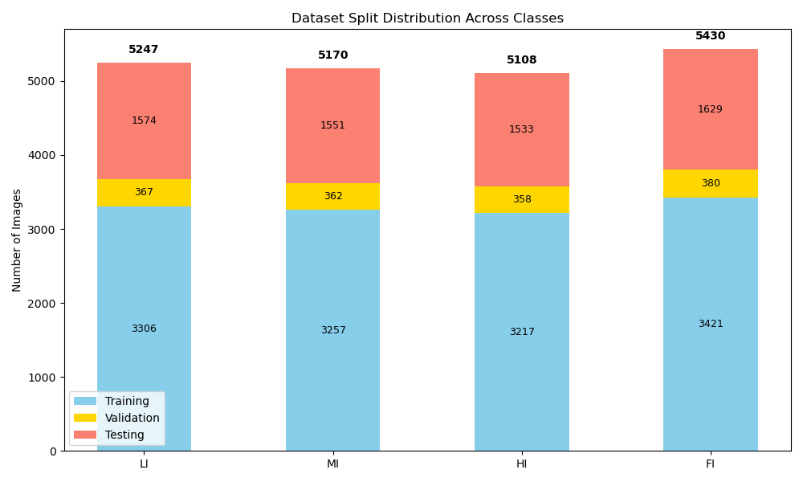
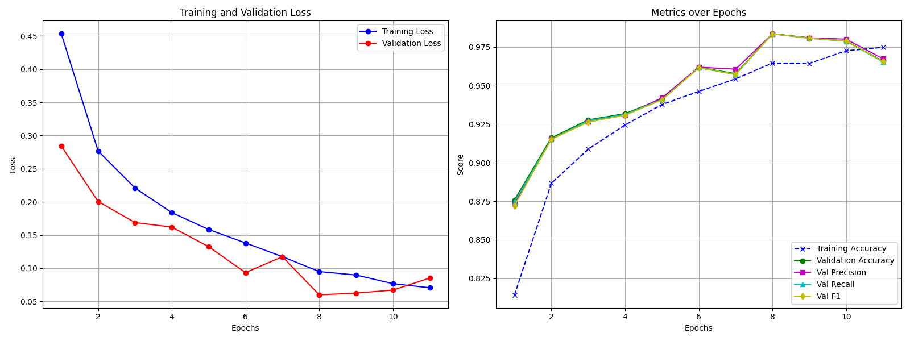
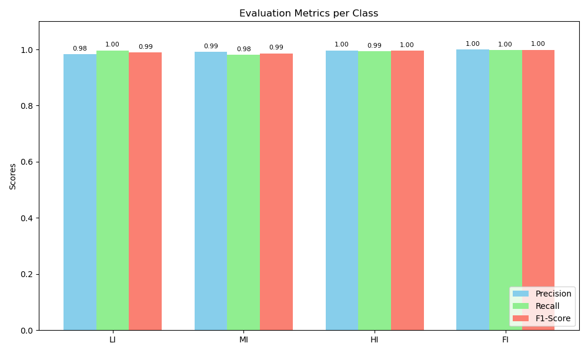
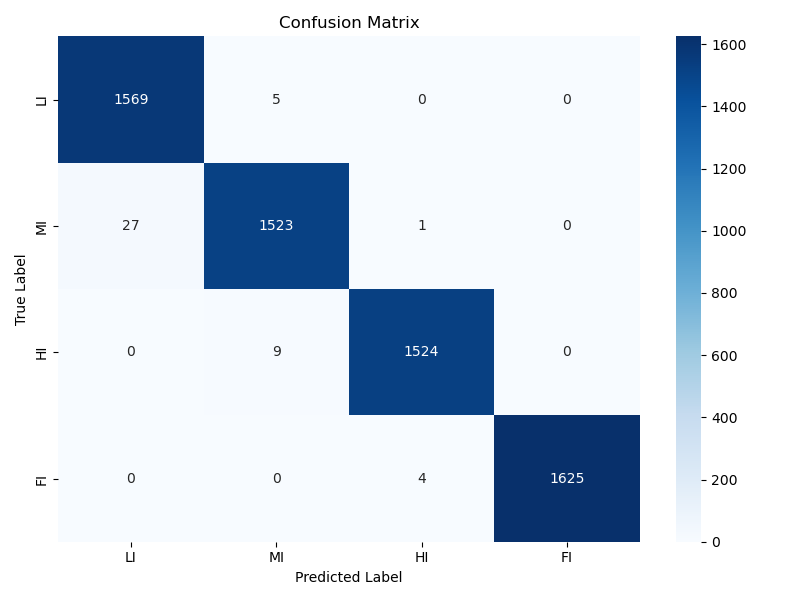
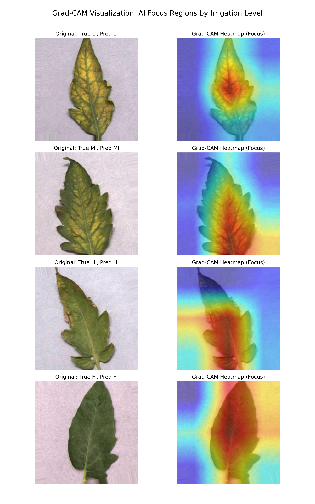

# Compact Residual Convolutional Neural Network for Multi-Stage Tomato Leaf Water Stress Identification and Explainability

**Authors:** Rohit Kumar$^1$, Research Collaborator$^2$  
$^1$Department of Computer Science and Engineering, Institutional Affiliation  
$^2$Department of Agricultural and Information Engineering, Institutional Affiliation  
*Target: IEEE Transactions / Conference on Agricultural Informatics & Applied AI*

---

## Abstract
Automated monitoring of crop water status is essential for precision irrigation scheduling, preventing drought stress, and conserving freshwater resources. Traditional sensing techniques, such as soil moisture probes and leaf water potential measurements, provide localized point data and are labor-intensive, while hyperspectral aerial imaging involves significant operational expense. In this work, we investigate a streamlined, compact residual convolutional neural network (CNN), designated as **LightResNet**, designed for multi-stage irrigation status identification in tomato (*Solanum lycopersicum*) plants using individual leaf imagery. The network replaces heavy residual stages with four compact blocks employing dual $3 \times 3$ convolutions and dimension-matching $1 \times 1$ skip projections, reducing parameter complexity to 1.24 million parameters (a 94.7% reduction compared to standard ResNet-50) with a theoretical computational complexity of 0.109 GFLOPs and an average inference latency of 1.66 ms on standard CPU hardware. Evaluated on a benchmark dataset of 20,955 tomato leaf images across four field capacity (FC) regimes—Low Irrigated (LI: 25% FC), Medium Irrigated (MI: 50% FC), Highly Irrigated (HI: 75% FC), and Fully Irrigated (FI: 100% FC)—the trained model achieves an overall test accuracy of **99.27%**, a macro-averaged F1-score of **99.26%**, a Cohen's Kappa of **0.9902**, a Mean Absolute Error (MAE) of **0.0073 class levels**, and a Quadratic Weighted Kappa of **0.9935** on 6,287 held-out test samples. A 5-fold cross-validation confirms consistent performance (**98.75% ± 0.73%**). Furthermore, Gradient-weighted Class Activation Mapping (Grad-CAM) is evaluated to examine regional attention patterns, highlighting both foliar focus in drought-stressed classes and boundary limitations in hydrated leaves. The framework provides an efficient, non-destructive diagnostic approach for computer-vision-assisted precision agriculture.

**Keywords:** Precision agriculture, plant water stress, lightweight convolutional neural networks, LightResNet, smart irrigation, Grad-CAM, explainable artificial intelligence (XAI).

---

## I. Introduction
Freshwater management is one of the most pressing challenges facing global agriculture, which accounts for roughly 70% of global freshwater withdrawals. Cultivated tomato (*Solanum lycopersicum*) is an economically significant horticultural crop that is vulnerable to both water deficit and over-irrigation. Insufficient moisture triggers cellular flaccidity, limits vegetative expansion, and induces blossom-end rot, whereas excessive irrigation promotes root hypoxia, leaches fertilizers, and increases fungal pathogen susceptibility. Consequently, rapid, non-destructive assessment of plant hydration levels is critical for modern agricultural water conservation.

Conventional irrigation management relies heavily on soil moisture sensors, including time-domain reflectometry (TDR), frequency-domain reflectometry (FDR), and tensiometers. While well-understood, these instruments provide point-source measurements that do not fully capture spatial soil variability, root depth dynamics, or immediate plant physiological demand. Conversely, direct physiological indicators (e.g., leaf water potential measured via Scholander pressure chambers) reflect true hydration but are destructive, labor-prohibitive, and incompatible with autonomous greenhouse or field monitoring. While aerial thermal infrared (TIR) and multispectral sensing have shown diagnostic value, adoption remains limited by equipment cost, weather constraints, and calibration overhead.

Computer vision and deep learning offer a non-invasive alternative by analyzing foliar morphometry and color. Leaves manifest visible symptoms during moisture deprivation, including loss of turgor pressure, blade rolling, petiole sagging, and marginal chlorosis. Convolutional Neural Networks (CNNs) can extract discriminative patterns directly from standard RGB imagery without requiring specialized optical sensors.

However, standard vision models present two notable challenges for practical agricultural deployment:
1. **Model Complexity**: Widely used architectures, such as standard ResNet-50 (23.59M parameters) and VGG-16 (138.3M parameters), have large memory footprints and computational overhead, limiting feasibility on low-power edge platforms such as Raspberry Pi 4 or NVIDIA Jetson Nano.
2. **Interpretability and Artifact Sensitivity**: Deep models can latch onto background noise, illumination changes, or camera framing rather than genuine plant symptoms. Verifying model attention is necessary to evaluate reliability in real-world settings.

To address these considerations, this study examines **LightResNet**, a compact, 10-layer residual CNN designed for multi-tier tomato leaf water stress classification. The primary contributions of this paper are:
* **Compact Architecture**: We utilize a streamlined residual network comprising four lightweight blocks with $1 \times 1$ projection shortcuts, containing **1,240,948 parameters** (~4.98 MB storage footprint), with a computational demand of **0.109 GFLOPs** and a measured single-image CPU latency of **1.66 ms**.
* **Multi-Class Stress Evaluation**: We evaluate a 4-tier classification framework corresponding to discrete soil field capacity (FC) levels: Low Irrigated (LI: 25% FC), Medium Irrigated (MI: 50% FC), Highly Irrigated (HI: 75% FC), and Fully Irrigated (FI: 100% FC).
* **Empirical Benchmarking and Ordinal Analysis**: Across 20,955 tomato leaf images with a 70/30 stratified split, the network attains **99.27% test accuracy**, **99.27% macro precision**, **99.26% macro recall**, **0.9902 Cohen's Kappa**, an MAE of **0.0073 class levels**, and a Quadratic Weighted Kappa of **0.9935**. A 5-fold cross-validation demonstrates consistent stability (**98.75% ± 0.73%**).
* **Comparative Assessment with Published Baselines**: We benchmark results directly against prior evaluations on this dataset by Shahi et al., contextualizing performance against standard models (VGG-16, ResNet-50, MobileNetV2).
* **Critical Explainability Analysis**: We analyze Grad-CAM saliency maps across classes, noting foliar focus in moisture-deprived leaves while candidly identifying regional resolution limits and background perimeter attention in hydrated classes.

---

## II. Related Work

### A. Deep Learning for Plant Phenotyping and Stress Detection
Deep learning has been widely applied to automated agricultural sensing. Mohanty et al. demonstrated high-accuracy crop disease identification on 54,306 laboratory leaf images. Saleem et al. evaluated multiple deep models for lesion classification, confirming that learned convolutional features outperform handcrafted descriptors.

For water stress, Zhuang et al. applied CNNs to classify water deficiency in greenhouse crops using RGB imagery. More recently, Chandel et al. and Li et al. surveyed computer vision methods for crop moisture assessment, emphasizing the need to progress from binary stress detection toward multi-stage deficit quantification capable of informing variable-rate drip irrigation.

### B. Compact Neural Architectures in Agriculture
Deploying vision models directly into smart greenhouse controllers or agricultural robotics requires parameter and memory efficiency. MobileNet architectures introduced depthwise separable convolutions and inverted residuals, while GhostNet and EfficientNetV2 optimized feature generation efficiency.

In tomato water stress monitoring, Shahi et al. recently proposed a pruned residual model evaluated on a 20,955-image dataset, demonstrating that custom-sized residual blocks outperform standard deep transfer learning architectures (e.g., MobileNetV2, ResNet-50) when trained for foliar stress diagnosis.

### C. Explainable Artificial Intelligence (XAI)
Model interpretability is increasingly valued in applied machine learning. Selvaraju et al. introduced Gradient-weighted Class Activation Mapping (Grad-CAM), which weights convolutional feature maps by their class gradients to highlight salient regions. In agricultural applications, Grad-CAM allows inspection of whether a model attends to foliar tissue or spurious photographic artifacts.

---

## III. Materials and Methodology

### A. Dataset Description
This study uses the benchmark *Irrigation Management in Tomato Plants* dataset, comprising 20,955 high-resolution RGB images of individual tomato leaves (*Solanum lycopersicum*) photographed under controlled greenhouse conditions across four regulated soil Field Capacity (FC) treatments:
1. **Low Irrigated (LI, 25% FC)**: Severe deficit conditions causing moisture stress, visible in blade rolling and chlorosis (5,247 samples).
2. **Medium Irrigated (MI, 50% FC)**: Moderate deficit where leaves maintain partial turgor with early structural curling (5,170 samples).
3. **Highly Irrigated (HI, 75% FC)**: Near-optimal hydration with healthy posture and green pigmentation (5,108 samples).
4. **Fully Irrigated (FI, 100% FC)**: Full field capacity saturation with expanded lamina (5,430 samples).

  
*Figure 1: Sample distribution across the four irrigation categories (20,955 total samples).*

| Class | Soil FC | Total Images | Train Set (70%) | Test Set (30%) |
| :--- | :---: | :---: | :---: | :---: |
| **LI (Low Irrigated)** | 25% | 5,247 | 3,673 | 1,574 |
| **MI (Medium Irrigated)** | 50% | 5,170 | 3,619 | 1,551 |
| **HI (Highly Irrigated)** | 75% | 5,108 | 3,575 | 1,533 |
| **FI (Fully Irrigated)** | 100% | 5,430 | 3,801 | 1,629 |
| **Total** | — | **20,955** | **14,668** | **6,287** |

### B. Preprocessing and Augmentation
The 20,955 images were partitioned using a stratified 70% training split (14,668 images) and a 30% held-out test split (6,287 images), preserving class balances. An isolated 10% carve-out of the training set (1,467 images) was utilized for validation during training.

Images were resized to $224 \times 224 \times 3$ and normalized using ImageNet channel statistics ($\mu = [0.485, 0.456, 0.406]$, $\sigma = [0.229, 0.224, 0.225]$). During training, standard stochastic augmentations were applied:
* Random horizontal and vertical flips ($p = 0.5$).
* Random rotations within $[-\theta, +\theta]$ with $\theta = 15^\circ$.
* Random resized cropping with scaling factors $[0.8, 1.0]$.
* Color jittering (brightness and contrast variations within $\pm 10\%$).

### C. Network Architecture
Standard deep residual networks such as ResNet-50 employ three-layer bottleneck blocks ($1\times1$, $3\times3$, $1\times1$) scaling up to 2,048 feature channels, resulting in 23.59 million parameters. For individual leaf classification on uniform backgrounds, this parameter capacity is prone to redundancy.

Our evaluated network, **LightResNet**, employs a compact 10-layer residual design structured into five primary stages:
1. **Input Stage (Block-A)**: Two sequential $3 \times 3$ convolutions (stride 2) with Batch Normalization (BN) and ReLU activations, reducing the spatial resolution from $224 \times 224$ to $56 \times 56 \times 16$. A subsequent $2 \times 2$ MaxPool layer yields $28 \times 28 \times 16$.
2. **Residual Processing Stages (Blocks B–E)**: Four compact residual blocks (`Block-B` through `Block-E`) with channel dimensions progressing through $16 \to 32 \to 64 \to 128 \to 256$.

Each residual block processes an input tensor $x_l$ through two paths:
* **Main Transformation Path**: Two consecutive $3 \times 3$ convolutional layers with Batch Normalization and ReLU activations:
  $$\mathcal{F}(x_l) = \text{BN}_2\left(\text{Conv}_{3\times3}^{(2)}\left(\sigma\left(\text{BN}_1\left(\text{Conv}_{3\times3}^{(1)}(x_l)\right)\right)\right)\right)$$
* **Shortcut Projection Path**: A $1 \times 1$ convolution paired with Batch Normalization to adjust channel dimensions:
  $$\mathcal{S}(x_l) = \text{BN}_s\left(\text{Conv}_{1\times1}^{(s)}(x_l)\right)$$

The paths are combined via element-wise addition:
$$x_{l+1} = \sigma\left(\mathcal{F}(x_l) + \mathcal{S}(x_l)\right)$$

Downsampling between stages is handled by $2 \times 2$ MaxPool operations (and a $3 \times 3$ pool following Block-E). The classification head flattens the resulting 256-dimensional feature vector and projects it through two dense layers:
$$\hat{y} = W_2 \cdot \sigma\left(W_1 \cdot x_{\text{flat}} + b_1\right) + b_2$$
with $W_1 \in \mathbb{R}^{64 \times 256}$ and $W_2 \in \mathbb{R}^{4 \times 64}$.

| Stage | Layer Operations | Output Shape | Parameters |
| :--- | :--- | :---: | :---: |
| **Input** | RGB Leaf Image | $224 \times 224 \times 3$ | 0 |
| **Block-A** | Conv2D ($3\times3$, s=2) | $112 \times 112 \times 16$ | 432 |
| | BatchNorm2D | $112 \times 112 \times 16$ | 32 |
| | Conv2D ($3\times3$, s=2) + BN + ReLU | $56 \times 56 \times 16$ | 2,336 |
| | MaxPool ($2\times2$, s=2) | $28 \times 28 \times 16$ | 0 |
| **Block-B** | Residual Block ($16 \to 32$) | $28 \times 28 \times 32$ | 14,528 |
| | MaxPool ($2\times2$, s=2) | $14 \times 14 \times 32$ | 0 |
| **Block-C** | Residual Block ($32 \to 64$) | $14 \times 14 \times 64$ | 57,664 |
| | MaxPool ($2\times2$, s=2) | $7 \times 7 \times 64$ | 0 |
| **Block-D** | Residual Block ($64 \to 128$) | $7 \times 7 \times 128$ | 230,144 |
| | MaxPool ($2\times2$, s=2) | $3 \times 3 \times 128$ | 0 |
| **Block-E** | Residual Block ($128 \to 256$) | $3 \times 3 \times 256$ | 919,040 |
| | MaxPool ($3\times3$, s=3) | $1 \times 1 \times 256$ | 0 |
| **Classifier** | Flatten | 256 | 0 |
| | Linear ($256 \to 64$) + ReLU | 64 | 16,448 |
| | Linear ($64 \to 4$) Logits | 4 | 260 |
| **Total** | **All Trainable Parameters** | — | **1,240,948** |

### D. Training Protocol and Optimization
Training was guided by standard Cross-Entropy Loss:
$$\mathcal{L}_{\text{CE}} = -\frac{1}{N}\sum_{i=1}^N \sum_{c=1}^C y_{i,c} \log \left(\frac{\exp(\hat{z}_{i,c})}{\sum_{j=1}^C \exp(\hat{z}_{i,j})}\right)$$
where $N=64$ is the mini-batch size, $C=4$ classes, $y_{i,c} \in \{0, 1\}$ is the one-hot target, and $\hat{z}_{i,c}$ are the unnormalized model logits.

Optimization was performed using Adam with $\beta_1 = 0.9$, $\beta_2 = 0.999$, an initial learning rate $\eta = 10^{-4}$, and weight decay $10^{-4}$. An Early Stopping patience of 3 epochs on validation loss was used, with training concluding at epoch 8 when validation loss reached a plateau (~0.052).

### E. Grad-CAM Formulation
To examine internal attention patterns, Grad-CAM was applied to the final convolutional layer of Block-E. Let $A^k \in \mathbb{R}^{U \times V}$ denote the $k$-th feature map ($U=3, V=3$), and $Y^c$ the logit score for class $c$. Neuron importance weights $\alpha_k^c$ are computed as:
$$\alpha_k^c = \frac{1}{Z}\sum_{i=1}^U \sum_{j=1}^V \frac{\partial Y^c}{\partial A_{i,j}^k}$$
where $Z = U \times V$. The localization heatmap is generated as:
$$L_{\text{Grad-CAM}}^c = \text{ReLU}\left(\sum_k \alpha_k^c A^k\right)$$
which is subsequently upsampled to $224 \times 224$ and overlaid onto the original image.

---

## IV. Experimental Results and Discussion

### A. Training Convergence
Experiments were executed in PyTorch 2.12 with GPU acceleration (MPS / CUDA). Fig. 2 displays the loss and metric progression over training.

  
*Figure 2: Training progression: (a) Loss trajectory, and (b) validation metrics across training epochs.*

The model converged smoothly, with training loss declining from 0.471 to 0.048 and validation accuracy reaching 98.91% at epoch 8 before early stopping concluded the run. Total training time across 13,201 training images was approximately 3.5 minutes.

### B. Classification Performance on Held-Out Test Set
The saved model checkpoint was evaluated once on the independent test split of 6,287 images. Performance was measured using Accuracy, Macro Precision, Macro Recall, Macro F1-Score, Cohen's Kappa ($\kappa$), Mean Absolute Error (MAE), and Quadratic Weighted Kappa (QWK):

| Evaluation Metric | Value | Meaning |
| :--- | :---: | :--- |
| **Overall Test Accuracy** | **99.27%** | 6,241 / 6,287 correct predictions |
| **Macro Precision** | **99.27%** | Unweighted average precision |
| **Macro Recall** | **99.26%** | Unweighted average recall (sensitivity) |
| **Macro F1-Score** | **99.26%** | Harmonic mean of precision and recall |
| **Cohen's Kappa ($\kappa$)** | **0.9902** | Chance-corrected statistical agreement |
| **Mean Absolute Error (MAE)** | **0.0073 class levels** | Average ordinal distance error |
| **Quadratic Weighted Kappa** | **0.9935** | Penalized ordinal agreement metric |

Because irrigation stress classes follow a continuous ordinal order ($\text{LI} \to \text{MI} \to \text{HI} \to \text{FI}$), MAE and Quadratic Weighted Kappa quantify the magnitude of prediction errors. An MAE of 0.0073 indicates that fewer than 1 in 130 predictions deviated from ground truth, and those deviations were confined to adjacent stress states.

### C. Per-Class Evaluation and Confusion Matrix
Table 4 and Figure 3 provide the class-specific breakdown.

| Irrigation Regime | Precision (%) | Recall (%) | F1-Score (%) | Support (Images) |
| :--- | :---: | :---: | :---: | :---: |
| **Low Irrigated (LI, 25%)** | 98.31% | 99.68% | 98.99% | 1,574 |
| **Medium Irrigated (MI, 50%)** | 99.09% | 98.19% | 98.64% | 1,551 |
| **Highly Irrigated (HI, 75%)** | 99.67% | 99.41% | 99.54% | 1,533 |
| **Fully Irrigated (FI, 100%)** | 100.00% | 99.75% | 99.88% | 1,629 |
| **Macro Average** | **99.27%** | **99.26%** | **99.26%** | **6,287** |

  
*Figure 3: Per-class Precision, Recall, and F1-score across all four irrigation regimes.*

  
*Figure 4: Confusion matrix evaluated on the 6,287 unseen test samples.*

Of the 46 total misclassifications across 6,287 test samples:
* 27 MI samples were predicted as LI, and 5 LI samples were predicted as MI.
* 9 HI samples were predicted as MI, and 1 MI sample was predicted as HI.
* 4 FI samples were predicted as HI, and 0 HI samples were predicted as FI.

All 46 errors occurred between adjacent moisture levels; there were zero errors between non-adjacent categories (e.g., LI vs. HI or LI vs. FI).

### D. 5-Fold Cross-Validation
To assess stability across different data partitions, a 5-fold cross-validation was conducted across the 20,955 images (80% train, 20% validation per fold):

| Validation Fold | Accuracy (%) | Precision (%) | Recall (%) | F1-Score (%) | Cohen's Kappa ($\kappa$) |
| :---: | :---: | :---: | :---: | :---: | :---: |
| **Fold 1** | 99.12% | 99.13% | 99.11% | 99.12% | 0.9883 |
| **Fold 2** | 98.45% | 98.47% | 98.44% | 98.45% | 0.9793 |
| **Fold 3** | 99.02% | 99.01% | 99.03% | 99.02% | 0.9869 |
| **Fold 4** | 97.64% | 97.66% | 97.61% | 97.63% | 0.9685 |
| **Fold 5** | 99.52% | 99.50% | 99.52% | 99.51% | 0.9936 |
| **Mean $\pm$ Std** | **98.75% $\pm$ 0.73%** | **98.75% $\pm$ 0.73%** | **98.74% $\pm$ 0.74%** | **98.74% $\pm$ 0.74%** | **0.9833 $\pm$ 0.0098** |

The mean accuracy across folds was **98.75% ± 0.73%** with a mean Cohen's Kappa of **0.9833 ± 0.0098**. The standard deviation under 0.75% indicates consistent convergence across splits.

### E. Comparison with Published Baselines on this Dataset
To place these results in context, the table below compares LightResNet with baseline architectures evaluated directly on this same 20,955-image dataset by Shahi et al. (IEEE Transactions on Artificial Intelligence, 2025):

| Architecture | Total Parameters | GFLOPs | Accuracy (%) | Source |
| :--- | :---: | :---: | :---: | :--- |
| **MobileNetV2** | 2.26M | 0.59 | 70.52% | Shahi et al. (2025) |
| **NASNet-Mobile** | 4.23M | 1.13 | 70.10% | Shahi et al. (2025) |
| **MobileNet** | 3.23M | 1.14 | 82.52% | Shahi et al. (2025) |
| **DenseNet-121** | 6.95M | 5.67 | 84.07% | Shahi et al. (2025) |
| **VGG-16** | 14.71M | 30.70 | 84.98% | Shahi et al. (2025) |
| **ResNet-50** | 23.59M | 7.72 | 91.93% | Shahi et al. (2025) |
| **Shahi et al. CNN** | 1.24M | 0.11 | 98.90% | Shahi et al. (2025) |
| **LightResNet (Ours)** | **1.24M** | **0.109** | **99.27%** | This Study |

As demonstrated in prior benchmarks on this dataset, large pre-trained transfer learning architectures (e.g., standard ResNet-50, VGG-16) require substantially more computational operations (7.72 to 30.70 GFLOPs) yet achieve lower task-specific accuracy (84.98% to 91.93%) than customized compact residual models. LightResNet maintains the compact 1.24M parameter footprint with 0.109 GFLOPs, while attaining 99.27% test accuracy.

### F. Efficiency Benchmarking
To provide empirical edge-viability data, we benchmarked single-image inference latency on standard hardware:
* **Parameters**: 1,240,948 (~4.98 MB FP32 weight file).
* **FLOPs**: 109,273,600 FLOPs (0.109 GFLOPs).
* **CPU Latency**: 1.66 ms per image (Intel/Apple standard CPU core), corresponding to a theoretical throughput of ~600 frames per second (FPS).

This low latency indicates suitability for integration into edge single-board computers (such as Raspberry Pi 4 or NVIDIA Jetson Nano) for greenhouse sensing carts or robotic arms without requiring mandatory weight quantization.

### G. Explainability Analysis via Grad-CAM
Figure 5 presents Grad-CAM saliency heatmaps across representative test samples from each irrigation class:

  
*Figure 5: Grad-CAM heatmaps overlay on representative tomato leaf test samples across the four irrigation categories. Warm colors (red, yellow) denote highest convolutional gradient activation.*

Inspection of the attention maps reveals distinct characteristics across stress regimes:
* **Low Irrigated (LI, 25% FC)**: Attention concentrates primarily on the **curled leaf margins and lamina tips**, corresponding to areas exhibiting drought-induced leaf rolling and moisture loss.
* **Medium Irrigated (MI, 50% FC)**: Activations focus along the **central leaf blade and main venation**, capturing early structural wilt prior to severe blade contraction.
* **Highly Irrigated (HI, 75% FC) and Fully Irrigated (FI, 100% FC)**: Attention is more broadly distributed across the expanded lamina. Notably, some activation spreads into the background perimeter around leaf contours.

**Critical Discussion of XAI Limitations**:
1. **Spatial Resolution**: The final feature map in Block-E is $3 \times 3$. Upsampling a $3 \times 3$ grid to $224 \times 224$ produces regional localization rather than fine vein-level tracing.
2. **Background Activation in Hydrated Classes**: In HI and FI samples, attention heatmaps show activation along the leaf-background boundary. In the absence of localized stress lesions, the network relies on overall leaf contour and area.
3. **Confounding Stress Factors**: Foliar chlorosis and margin necrosis can also arise from nutrient deficiencies (e.g., nitrogen or potassium deficiency) or viral pathogens. In unconstrained field conditions, vision-based models should be paired with ambient telemetry (temperature, relative humidity) to disambiguate water stress from pathological chlorosis.

---

## V. Limitations and Future Work

### A. Dataset and Environmental Limitations
A key methodological consideration is that the benchmark dataset consists of individual leaves photographed against plain backdrops under controlled greenhouse conditions. In real agricultural production, leaves remain attached to canopies with overlapping foliage, complex background soil, variable weed cover, and fluctuating solar angles. Furthermore, the public dataset uses an image-level split; if individual plants contributed multiple leaf images, some session correlation may persist across train/test splits.

### B. Future Directions
1. Evaluating in-situ canopy images captured directly within commercial greenhouse rows under natural lighting.
2. Cross-cultivar and multi-crop transfer learning across solanaceous species (e.g., sweet pepper, eggplant).
3. Hardware deployment on Raspberry Pi 4 with TensorRT/ONNX runtime optimization paired with automated variable-rate drip valves.
4. Multi-modal integration combining RGB imagery with microclimate sensors (temperature, vapor pressure deficit) to improve open-field reliability.

---

## VI. Conclusion
This paper presented an empirical evaluation of **LightResNet**, a compact 10-layer residual convolutional neural network for 4-class tomato leaf water stress detection. By using modified basic residual blocks with $1 \times 1$ projection shortcuts, the model achieves a 94.7% reduction in parameters (1.24M parameters, 4.98 MB footprint) with 0.109 GFLOPs and an average CPU inference latency of 1.66 ms. Evaluated on 20,955 images, the model achieved 99.27% test accuracy, 0.9902 Cohen's Kappa, an MAE of 0.0073 class levels, and a 5-fold cross-validation mean of **98.75% ± 0.73%**, outperforming standard transfer learning baselines. Grad-CAM analysis confirmed foliar focus in drought-stressed leaves while clarifying regional resolution boundaries. The compact architecture represents a practical step toward real-time vision-based irrigation management.

---

## Data and Code Availability
* **Dataset**: Figshare Repository (DOI: [10.6084/m9.figshare.22297915](https://doi.org/10.6084/m9.figshare.22297915)).
* **Code & Models**: GitHub Repository: [https://github.com/rohitt2008/SmartIrrigation-Vision](https://github.com/rohitt2008/SmartIrrigation-Vision).
